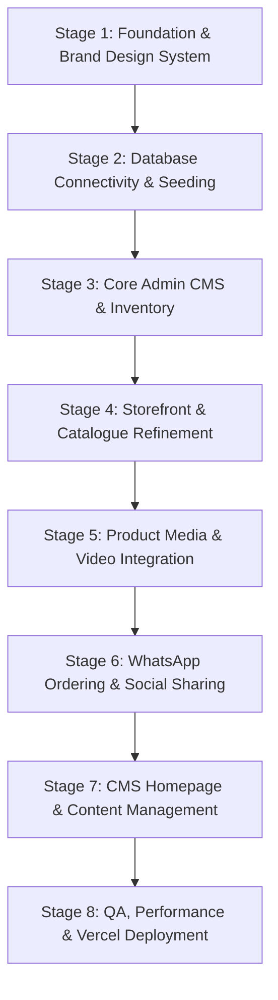

# AWWALSHOP — Master Development Plan

> **Tagline:** Elegance in Every Detail.  
> **Brand Positioning:** Modern African Luxury.  
> **Initial Focus:** Curated jewellery, fine timepieces, bespoke traditional attire (kaftans, agbadas), leather footwear, and lifestyle accessories.

> **Current build scope:** The public storefront is a catalogue-only experience.
> Homepage, about, contact and collection routes are retained as legacy redirects
> to `/shop`. The admin is focused on products, categories, collections, media and
> business settings; the homepage, navigation and testimonial editors described in
> Stage 7 are not part of the current build and remain future work.

---

## 1. Executive Summary & Architecture Overview

Awwalshop is built as a flexible, CMS-driven product catalogue and WhatsApp-ordering platform. Rather than a hardcoded single-niche storefront, it provides:
1. **Public Storefront:** An editorial luxury discovery experience with instant search, category filtering, dedicated product detail pages, and direct WhatsApp order generation.
2. **Admin CMS:** A secure administrative portal allowing non-technical business owners to manage products, categories, collections, media, testimonials, homepage sections, and business parameters.

### Core Technology Stack

| Layer | Technology | Details / Rationale |
|---|---|---|
| **Framework** | Next.js 16 (App Router) | Server Components, Server Actions, Dynamic Metadata (`generateMetadata`), and `proxy.ts` routing convention. |
| **Language** | TypeScript (Strict) | End-to-end type safety across database schemas, APIs, and UI components. |
| **Styling** | Tailwind CSS v4 | Custom luxury design tokens (Deep Espresso `#241C19`, Warm Ivory `#F8F5EF`, Champagne Gold `#C5A46D`, Soft Sand `#E8DED0`). |
| **Database** | PostgreSQL (Neon) | Scalable, serverless relational database with ACID compliance. |
| **ORM** | Prisma 6 | Type-safe query building, migrations, and automated schema synchronization. |
| **Authentication** | NextAuth v5 (Auth.js) | JWT session management with HTTP-only secure cookies and bcrypt password hashing. |
| **Media Storage** | Cloudinary + oEmbed | Direct image/video uploads with auto-optimization, plus external YouTube & Vimeo video embedding. |
| **Ordering Channel** | WhatsApp Business API / wa.me | Conversational commerce: prefilled, URL-encoded order inquiries with variants, quantity, and product URLs. |
| **Validation** | Zod | Runtime validation for server actions, API routes, and client forms. |

---

## 2. Phased Implementation Roadmap

---

### Stage 1: Foundation & Brand Design System (Completed & Verified)
- [x] Establish luxury design tokens (Deep Espresso, Warm Ivory, Champagne Gold, Soft Sand) in `globals.css`.
- [x] Configure typography: Cormorant Garamond (Headings) and DM Sans (Body).
- [x] Reusable SVG brand assets (horizontal logo, stacked logo, monogram symbol).
- [x] Layout architecture separating storefront `app/(storefront)` and administrative CMS `app/admin`.
- [x] Route protection proxy convention (`proxy.ts`).
- [x] NextAuth v5 session management & authentication setup (`lib/auth.ts`).
- [x] Stable Prisma 6 client generated (`prisma/schema.prisma`).
- [x] TypeScript verification (`tsc --noEmit`) passing with 0 errors.

---

### Stage 2: Database Connectivity & Seeding
**Objective:** Connect the application to a live PostgreSQL instance (Neon) and seed the initial dataset.

1. **Environment Configuration:**
   - Configure `DATABASE_URL` in `.env.local`.
   - Set up `AUTH_SECRET` and `NEXT_PUBLIC_SITE_URL`.
2. **Schema Migration:**
   - Run `npx prisma db push` or `npx prisma migrate dev` to generate tables, indexes, and relations.
3. **Database Seeding:**
   - Execute `npx prisma db seed` to insert:
     - 5 Core Categories (Fine Jewellery, Traditional Attire, Timepieces, Leather Footwear, Accessories).
     - 3 Featured Collections (New Arrivals, Signature Luxury, Best Sellers).
     - Initial luxury demonstration products with pricing and specifications.
     - Default Business Settings and WhatsApp message template.
4. **Initial Admin Account:**
   - Seed the initial admin user with bcrypt-hashed credentials.

---

### Stage 3: Core Admin CMS & Product Management
**Objective:** Provide full inventory and taxonomy control for the store administrator.

1. **Product CRUD Operations:**
   - Server Actions for product creation, editing, publishing/unpublishing, and deletion.
   - Dynamic product edit view at `/admin/products/[id]`.
   - Product duplication support.
2. **Category & Taxonomy Management:**
   - Support parent and child category relationships.
   - Category banners, descriptions, and sort orders at `/admin/categories`.
3. **Collection Management:**
   - Curated collections management at `/admin/collections`.
4. **Admin Activity Logging:**
   - Audit trail tracking modifications across products and settings.

---

### Stage 4: Storefront Experience & Catalogue Refinement (Completed & Verified)
**Objective:** Deliver an editorial customer journey on mobile and desktop.

1. **Catalogue Filtering & Search:**
   - [x] Multi-criteria filtering: Category, Subcategory, Collection, Price range, Availability.
   - [x] Instant search across product titles, descriptions, SKUs and materials.
   - [x] Sorting by Newest, Price (Low to High / High to Low), and Featured status.
2. **Pagination & Load-More:**
   - [x] Offset pagination with preserved query parameters.
3. **Dedicated Product Detail Pages (`/products/[slug]`):**
   - [x] Rich media gallery, specifications list, variant pickers, and availability indicator.
   - [x] Homepage, collections index/detail, about and contact pages built on live CMS/DB data.
   - [x] Responsive layouts for mobile, tablet and desktop viewports.

---

### Stage 5: Product Media System (Uploads & External Video)
**Objective:** Coexistence of Cloudinary direct uploads, external image links, and video players.

1. **Direct Upload System:**
   - Cloudinary upload helper exists (`lib/cloudinary.ts`); upload API route and admin drag-and-drop UI still to be built.
   - [ ] Server-side Cloudinary upload handling with MIME validation and size limits.
   - [ ] Drag-and-drop file uploader with upload progress and thumbnail preview.
   - [ ] Automatic format optimization (WebP/AVIF).
2. **External Media & Video Integration:**
   - [x] Automatic detection of YouTube, Vimeo, direct MP4, and external image URLs.
   - [x] Embedded players with fallback poster images.
3. **Gallery Controls:**
   - [x] Storefront gallery with thumbnails, video posters and active-media selection.
   - [ ] Drag-and-drop reordering and primary media selection in the admin.

---

### Stage 6: WhatsApp Ordering & Social Sharing (Completed & Verified)
**Objective:** Flawless conversational commerce and link shareability.

1. **WhatsApp URL Generation:**
   - [x] Dynamic message formatting incorporating selected variant (e.g. Ring Size 9, 18k Champagne Gold), quantity, total price, and product canonical URL.
   - [x] Cross-platform support (`wa.me` redirecting seamlessly to WhatsApp Mobile App or WhatsApp Web).
   - [x] Template read from CMS `BusinessSettings.whatsappMessage` with live price/quantity recalculation.
2. **Dynamic Social Metadata (Open Graph & Twitter Cards):**
   - [x] `generateMetadata` implementation on product and collection detail pages.
   - [x] Auto-generated `sitemap.xml` and `robots.txt`.
   - [x] Product JSON-LD structured data.
3. **Share Features:**
   - [x] Native Web Share API integration on mobile.
   - [x] Clipboard copy with instant visual confirmation.

---

### Stage 7: CMS Dynamic Content & Business Settings (Completed & Verified)
**Objective:** Ensure 100% of storefront content is editable without code modification.

1. **Homepage Content Editor (`/admin/homepage`):**
   - [x] Hero headline, eyebrow, supporting description, call-to-action button texts and destinations.
   - [x] Hero background imagery and brand story imagery with live previews.
   - [x] Editorial brand story heading and paragraph manager (used on the homepage and Our Heritage page).
2. **Testimonials Manager (`/admin/testimonials`):**
   - [x] Add, edit, publish/unpublish and delete client reviews with star ratings and photos.
   - [x] Sort ordering and published/draft status shown in the admin list.
3. **Business Settings Editor (`/admin/settings`):**
   - [x] Business name, tagline, phone, email, showroom address and opening hours.
   - [x] WhatsApp number and default inquiry message template with placeholder guidance.
   - [x] Currency code (`NGN`, `USD`, `GBP`, `EUR`), currency symbol, delivery and processing information.
   - [x] Social profile links wired through to the storefront footer.
   - [x] Default SEO title and description wired through to the site metadata.
   - [x] All mutations require an authenticated admin session, validate with Zod and write to the activity log.

---

### Stage 8: Quality Assurance, Security & Deployment
**Objective:** Verify security, accessibility, Core Web Vitals, and prepare for production launch.

1. **Security Hardening:**
   - Rate limiting on `/admin/login` to prevent brute-force attacks.
   - Server-side session verification on all mutating Server Actions.
   - Input sanitization and upload validation.
2. **Mobile & Accessibility Testing:**
   - Screen reader attributes (`aria-label`, semantic landmarks).
   - Keyboard navigation and visible focus rings.
   - Touch-target sizes (minimum 44x44px).
3. **Production Deployment (Vercel):**
   - Connect repository to Vercel.
   - Configure Environment Variables (`DATABASE_URL`, `AUTH_SECRET`, `CLOUDINARY_*`).

---

## 3. Future Expansion Roadmap (Phases 2 – 6)

The architecture is prepared for seamless transition into transactional e-commerce in future versions:

- **Phase 2 (Shopping Cart & Accounts):** Cart drawer, persistent user accounts, saved wishlists.
- **Phase 3 (Online Payments):** Paystack & Flutterwave gateway integrations for instant card/bank checkout.
- **Phase 4 (Order Tracking):** Automated order receipts, order statuses (Processing, Shipped, Delivered), and customer tracking links.
- **Phase 5 (Inventory Control):** Stock quantity counters, low-stock notifications, automated out-of-stock transitions.
- **Phase 6 (Business Analytics):** Conversion rate tracking, most viewed pieces, and WhatsApp click analytics.

---

## 4. Definition of Done Checklist

- [ ] Storefront displays live database items (no hardcoded catalogue data).
- [ ] Admin can log in securely and maintain access via HTTP-only session cookies.
- [ ] Admin can create, update, unpublish, and delete products with multiple images/videos.
- [ ] WhatsApp ordering button opens with exact product details and selected variants.
- [ ] Social links show custom Open Graph cards on WhatsApp, iMessage, and Twitter.
- [ ] CMS allows editing business WhatsApp number, tagline, and homepage text.
- [ ] Site is responsive and functional on mobile, tablet, and desktop viewports.
- [ ] Ready for zero-downtime deployment on Vercel.

